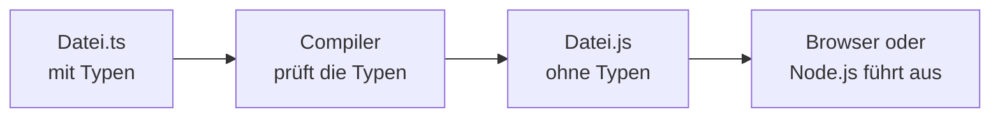

# TypeScript: Daten beschreiben (Typen)

TypeScript ist JavaScript mit einer Zusatzschicht: den **Typen**. Ein Typ sagt, was für ein Wert an einer Stelle erlaubt ist. Der Compiler prüft das, bevor das Programm läuft. Dieses Infoblatt erklärt die Typen, die du für Angular am häufigsten brauchst.

## 1. Was ist TypeScript?

Du schreibst Code in einer `.ts`-Datei. Der **Compiler** prüft die Typen und erzeugt daraus gewöhnliches JavaScript. Das läuft im Browser oder in Node.js.



:::info Typen gibt es nur beim Schreiben
Im fertigen JavaScript sind alle Typen verschwunden. Ein Typfehler bricht das Programm deshalb nicht ab, der Compiler **warnt** nur. In Java ist das anders: Dort prüft der Compiler Typen, und die Klassen gibt es zur Laufzeit noch.
:::

Die Prüfung ist so streng, wie du sie einstellst. In diesem Kurs gilt immer `"strict": true` (Voreinstellung in jedem Angular-Projekt). Wenn von „dem Compiler“ die Rede ist, ist diese strenge Einstellung gemeint.

## 2. Typen für einfache Werte

| Typ | Beispiele | Java |
|---|---|---|
| `string` | `'Drucker'`, `"Büro"` | `String` |
| `number` | `7`, `3.14` | `int`, `double` (alles eine Zahlenart) |
| `boolean` | `true`, `false` | `boolean` |

```ts
const title: string = 'Drucker defekt';
let count: number = 3;
```

Meistens musst du den Typ gar nicht hinschreiben. Der Compiler erkennt ihn am Wert (**Typinferenz**):

```ts
const title = 'Drucker defekt'; // string
let count = 3;                  // number
count = 'drei';                 // Fehler: ein Text ist keine Zahl
```

**`const` oder `let`?** Benutze `const`, wenn der Name sich nicht ändert (fast immer), und `let` nur, wenn du ihm später etwas anderes zuweist. Das alte `var` benutzt man nicht mehr.

## 3. Daten beschreiben: `interface`

Ein **Interface** beschreibt die Form eines Objekts: welche Felder es gibt und welchen Typ sie haben.

```ts
interface Ticket {
  readonly id: number;   // nur lesbar
  title: string;
  assignee?: string;     // optional: darf fehlen
}

const ticket: Ticket = { id: 7, title: 'Drucker defekt' };
```

| Schreibweise | Bedeutung |
|---|---|
| `title: string` | Pflichtfeld |
| `assignee?: string` | Das Feld darf fehlen. Fehlt es, ist sein Wert `undefined`. |
| `readonly id: number` | Das Feld darf nach dem Anlegen nicht mehr geändert werden. |

**Passt es, dann passt es.** TypeScript prüft die **Form** eines Objekts, nicht seinen Namen. Ein Objekt gilt als `Ticket`, wenn es alle Pflichtfelder mit den richtigen Typen hat. Du musst nirgends `implements Ticket` schreiben. Das nennt man **strukturelle Typisierung**.

Zwei Dinge fängt der Compiler dabei ab: ein fehlendes Pflichtfeld und ein unbekanntes Feld, zum Beispiel ein Tippfehler im Namen (`prio` statt `priority`).

### `interface` oder Klasse?

Ein `interface` beschreibt nur Daten, es **erzeugt nichts**. Im JavaScript ist es nach dem Kompilieren weg. Eine Klasse (`class`) dagegen gibt es auch zur Laufzeit. Für Daten, die aus einer Schnittstelle kommen (JSON), nimmst du ein Interface. Klassen brauchst du, wenn Objekte eigenes Verhalten oder einen eigenen Zustand haben (mehr dazu in AB 03).

## 4. Erlaubte Werte festlegen: Union-Typen

Ein **Union-Typ** nennt mehrere erlaubte Möglichkeiten, getrennt durch `|` (gesprochen „oder“). Besteht er aus festen Werten, spricht man von **Literal-Typen**:

```ts
type Status = 'offen' | 'in Arbeit' | 'erledigt';
type Priority = 1 | 2 | 3;

let status: Status = 'offen';
status = 'wartet';   // Fehler: "wartet" ist kein Status
```

Das ist die Antwort von TypeScript auf die Java-`enum`: Du nennst die Werte direkt, ohne eine eigene Klasse. Der Editor kann dir die gültigen Werte vorschlagen, und ein Tippfehler wird sofort rot.

Mit `type` gibst du einem Typ einen Namen. Das geht auch für Union-Typen, die du nicht in ein Interface schreiben kannst.

## 5. Wenn etwas fehlen kann: `undefined`, `?.` und `??`

Im strengen Modus ist `undefined` ein eigener Wert. Ein optionales Feld hat deshalb den Typ `string | undefined`, und der Compiler zwingt dich, das zu behandeln:

```ts
const name: string = ticket.assignee;
// Fehler: Type 'string | undefined' is not assignable to type 'string'
```

Zwei Operatoren helfen:

| Operator | Bedeutung | Beispiel |
|---|---|---|
| `?.` | **Optionaler Zugriff:** Ist der Wert davor `undefined` oder `null`, ist das Ergebnis `undefined` und es wird nichts mehr aufgerufen | `ticket.assignee?.toUpperCase()` |
| `??` | **Ersatzwert:** Ist der linke Wert `undefined` oder `null`, gilt der rechte | `ticket.assignee ?? 'nicht zugewiesen'` |

:::warning `??` ist nicht `||`
`||` ersetzt jeden „unechten“ Wert: `''`, `0`, `false`, `undefined`, `null`. `??` ersetzt nur `undefined` und `null`. Für Namen und Zahlen willst du meistens `??`, weil `0` und `''` echte Werte sein können.
:::

Auch eine Suche kann ins Leere laufen: `list.find(...)` liefert `Ticket | undefined`. Du musst den Fall „nichts gefunden“ behandeln, bevor du auf das Ergebnis zugreifst.

## 6. `any` und `unknown`

| Typ | Bedeutung | Wann |
|---|---|---|
| `any` | „Prüfe hier nichts.“ Der Compiler schaltet die Prüfung für diesen Wert ab. | **Möglichst nie.** Du verlierst genau den Nutzen von TypeScript. |
| `unknown` | „Ich weiß nicht, was das ist.“ Der Compiler verlangt, dass du es prüfst, bevor du es benutzt. | Für Werte, deren Typ du erst zur Laufzeit erfährst, zum Beispiel ein abgefangener Fehler. |

Wenn du einen Typ nicht kennst: `unknown` statt `any`.

## 7. Template-Strings

Zwischen **Backticks** (`` ` ``) kannst du Werte in einen Text einsetzen. Mit `${…}` steht an dieser Stelle ein beliebiger Ausdruck:

```ts
const zeile = `#${ticket.id} ${ticket.title}`;
// "#7 Drucker defekt"
```

Das ersetzt das Zusammenkleben mit `+`. Template-Strings kannst du über mehrere Zeilen schreiben.

## 8. Von Java nach TypeScript

| Java | TypeScript |
|---|---|
| `String`, `int`, `double`, `boolean` | `string`, `number`, `boolean` |
| Klasse nur für Daten, mit Gettern und Settern | `interface` (oft ohne Methoden) |
| `Optional<String>` oder `null` | `assignee?: string` (Wert dann `undefined`) |
| `enum Status { ... }` | `type Status = 'offen' \| 'erledigt'` |
| `List<String>` | `string[]` oder `Array<string>` |
| `final` | `const` (Variable), `readonly` (Feld) |
| Typen gibt es zur Laufzeit | Typen gibt es **nicht** zur Laufzeit |
| `null` kann überall stecken | Im strengen Modus muss `undefined` oder `null` im Typ stehen |
| Eigene Klasse muss `implements` schreiben | Passende Form genügt (strukturelle Typisierung) |

## 9. Compiler-Fehlermeldungen lesen

Der Compiler meldet auf Englisch. Jede Meldung hat das Muster:

```text
datei.ts(Zeile,Spalte): error TSxxxx: Text
```

Wichtig ist der **Text**. Die Tabelle übersetzt die häufigsten:

| Meldung (Auszug) | Bedeutung | Typische Ursache |
|---|---|---|
| `Type 'string' is not assignable to type 'number'` | Ein Text steht, wo eine Zahl erwartet wird (oder umgekehrt) | falscher Wert oder falscher Typ im Interface |
| `Type '"wartet"' is not assignable to type 'Status'` | Der Wert gehört nicht zu den erlaubten Werten | Tippfehler oder neuer Wert fehlt im Union-Typ |
| `Property 'titel' does not exist on type …` | Das Feld gibt es nicht | Tippfehler im Feldnamen (oft mit „Did you mean …?“) |
| `Argument of type 'string' is not assignable to parameter of type 'number'` | Beim Aufruf einer Funktion wurde der falsche Typ übergeben | falscher Parameter |
| `Property 'title' is missing in type … but required in type 'Ticket'` | Ein Pflichtfeld fehlt | Feld vergessen |
| `Object literal may only specify known properties` | Das Objekt hat ein Feld, das es im Typ nicht gibt | Tippfehler im Feldnamen |
| `Cannot assign to 'id' because it is a read-only property` | Ein `readonly`-Feld wurde geändert | Zuweisung an ein geschütztes Feld |
| `Object is possibly 'undefined'` | Der Wert kann fehlen und wurde ohne Prüfung benutzt | `find()` oder optionales Feld, Fall „fehlt“ nicht behandelt |
| `Type 'string \| undefined' is not assignable to type 'string'` | Ein optionaler Wert steht, wo ein Pflichtwert erwartet wird | Ersatzwert mit `??` oder Prüfung fehlt |
| `Unused '@ts-expect-error' directive` | In den Typ-Prüfungen dieses Kurses: Der erwartete Fehler bleibt aus | dein Typ ist an dieser Stelle noch zu locker |

**So gehst du vor:** Lies zuerst die **erste** Meldung, spätere sind oft Folgefehler. Gehe zu Zeile und Spalte. Lies den Text von links nach rechts: *Was habe ich geliefert, was wird erwartet?*
